# 06 — User Journeys & Experience Design Architecture

> **Volume 06 — Comprehensive User Journeys, Interaction Flows & Design Ergonomics**  
> **Prepared by:** Chief Design Officer & Lead Frontend Engineer  
> **Evidence Status:** `VERIFIED` across client implementation, navigation routes, and Figma UI screens

---

## 1. Core End-to-End User Journeys

```
┌────────────────────────────────────────────────────────────────────────┐
│                        PRIMARY USER JOURNEYS                           │
├─────────────────────┬─────────────────────┬────────────────────────────┤
│ 1. CONSUMER PATHS   │ 2. CREATOR PATHS    │ 3. OPERATIONAL PATHS       │
├─────────────────────┼─────────────────────┼────────────────────────────┤
│ • Hub Discovery     │ • Event Creation    │ • Admin Event Approval     │
│ • M-Pesa Checkout   │ • Live Analytics    │ • Gate Ticket Scanning     │
│ • Quest Check-In    │ • Payout Request    │ • Bartender Pass Redeem    │
│ • Offline Retrieval │ • Door Team Setup   │ • Fraud Dispute Triage     │
└─────────────────────┴─────────────────────┴────────────────────────────┘
```

---

### Journey 1: New User Onboarding & Cultural Discovery
- **User Role:** Consumer (`The Experience Seeker`).
- **Trigger:** First launch or opening a shared event deep-link.
- **Step-by-Step Flow:**
  1. *Splash & Welcome Animation (`app/onboarding.tsx`):* Displays cinematic brand mark (`#FF6B00` on `#0D0D0D`) with high-contrast cultural welcome copy and tagline *"Africa & the Caribbean to the World"*.
  2. *Authentication / Anonymous Browse (`app/login.tsx`):* User can immediately browse as a guest or sign in via email, Apple ID, Google, or SMS OTP.
  3. *Cultural Interest Selection:* User picks culture tags (Afrobeats, Amapiano, Carnival, Highlife, Food, Tech) to calibrate their recommendation feed.
  4. *Hub Selection (`app/(tabs)/index.tsx`):* Default opens to "🌍 Global Diaspora". User taps "🇬🇧 London" or "🇰🇪 Nairobi" to filter events instantly.
  5. *Culture Compass (`app/culture-compass.tsx`):* User taps "Map View", explores the SVG radar map, toggles category filters, and discovers venue pins.
- **Visual References:**
  - Splash Screen: `assets/kultr-splash.png`
  - Login Screen: `assets/kultr-login.png`
  - Interests Onboarding: `assets/kultr-onboarding-interests.png`
  - City Selection: `assets/kultr-city-selection-r.png`
  - Culture Compass: `assets/kultr-culture-compass.png`
  - Home Discovery: `assets/kultr-home.png`

| Step 1: Splash | Step 2: Login | Step 3: Interests | Step 4: Home Feed |
|:---:|:---:|:---:|:---:|
| 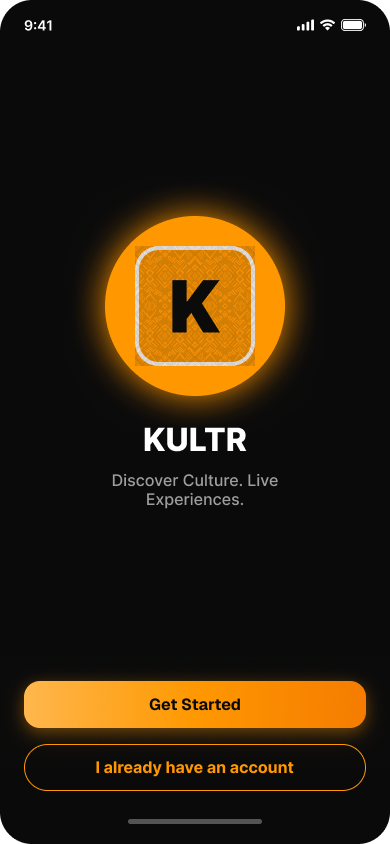 | 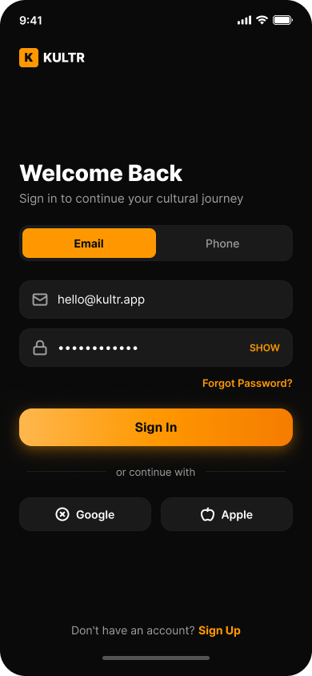 | 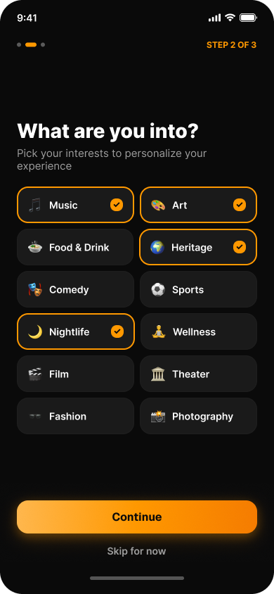 | 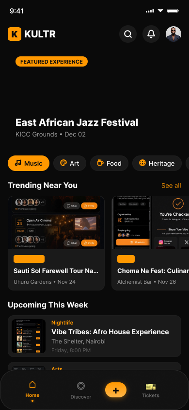 |

- **Haptic Feedback:** `Haptics.selectionAsync()` triggered on every hub and filter switch.

---

### Journey 2: Omnichannel Ticket Purchase with Canned Drink Bundle (M-Pesa STK Push)
- **User Role:** Consumer / Event Attendee.
- **Trigger:** Taps "Get Tickets" on `app/event/[id].tsx`.
- **Step-by-Step Flow:**
  1. *Ticket Selection (`app/event/[id].tsx`):* User selects 2x VIP Tickets (`ticketTypesTable`).
  2. *Beverage Add-on (`app/checkout/[eventId].tsx`):* Screen displays "Kultr Canned Drinks & Express Bar Pass" toggle. User adds 1x "Cold Brew 4-Pack" (30% discount, fast-track lane pass).
  3. *Order Review (`app/checkout-review.tsx`):* Transparent price breakdown showing base tickets, drinks add-on, tax, and total.
  4. *Payment Method Selection:* User taps "M-Pesa (Kenya)" and enters phone number (`0712 345 678`).
  5. *Payment Initiation:* Client dispatches `POST /api/payments/mpesa/stk-push`. Backend locks the ticket rows (`SELECT FOR UPDATE`), writes a `pending_payments` row, and calls Safaricom Daraja STK API.
  6. *SIM Toolkit Authorization:* The attendee's phone receives an immediate M-Pesa PIN prompt: *"Do you want to pay KES 5,200 to Kultr Events?"*. User enters secret PIN.
  7. *Verification & Celebration:* App polls `POST /api/payments/mpesa/verify`. Backend confirms receipt, atomically mints 2 tickets (`ticketsTable`) and 1 Bar Pass (`beverage_vouchers`), and triggers `Haptics.notificationAsync(Success)`.
  8. *Ticket Display:* App transitions to `CheckinCelebration` animation with confetti, then routes to digital ticket wallet.
- **Visual References:**
  - Event Details: `assets/kultr-event-detail.png`
  - Checkout Review: `assets/kultr-checkout-review-r.png`
  - Payment Method: `assets/kultr-payment-method-r.png`
  - Payment Processing: `assets/kultr-payment-processing-r.png`
  - Payment Celebration: `assets/kultr-payment-success.png`

| Event Details | Checkout Review | Payment Method | Success Celebration |
|:---:|:---:|:---:|:---:|
| 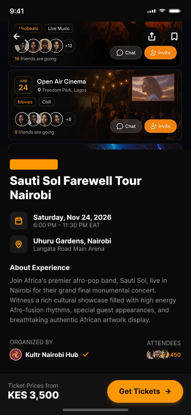 | 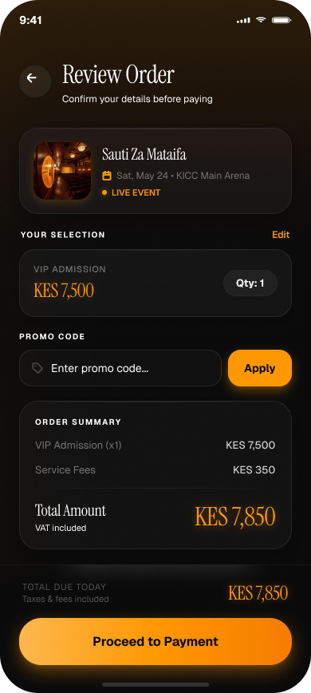 | 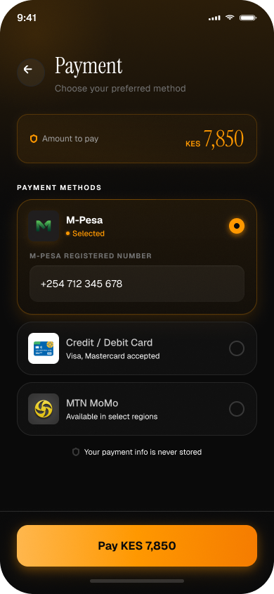 | 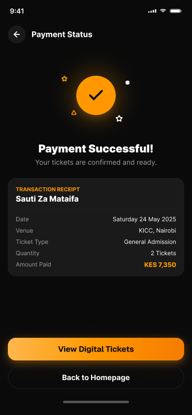 |

---

### Journey 3: Offline Ticket & Bar Pass Retrieval at Venue
- **User Role:** Event Attendee entering venue.
- **Condition:** Stadium or warehouse crowd causing 100% cellular data blackout.
- **Step-by-Step Flow:**
  1. *Opening Wallet (`app/(tabs)/tickets.tsx`):* App opens offline; cached tickets load instantly from AsyncStorage / SQLite.
  2. *Ticket QR Rendering (`app/ticket/[id].tsx`):* Dynamic SVG QR matrix renders the stored algorithmic SHA-256 hash.
  3. *Bar Pass Selection (`app/bar-pass/[id].tsx`):* Attendee switches to "Bar Passes" tab, revealing the HMAC-signed QR pass and numeric voucher code (`KULTR-XXXX-XXXX`).
  4. *Brightness & Legibility:* Screen enforces high-contrast background (`#000000`) ensuring optical scanners read the QR code on cracked or low-brightness smartphone screens.
  5. *Offline Indicator:* Non-intrusive banner confirms offline verification readiness without blocking UX.
- **Visual References:**
  - Digital Ticket & QR: `assets/kultr-digital-ticket.png`
  - Ticket History: `assets/kultr-ticket-history-r.png`
  - Offline Mode: `assets/kultr-offline-mode-r.png`

| Digital Ticket QR | Ticket History | Offline Mode State |
|:---:|:---:|:---:|
| 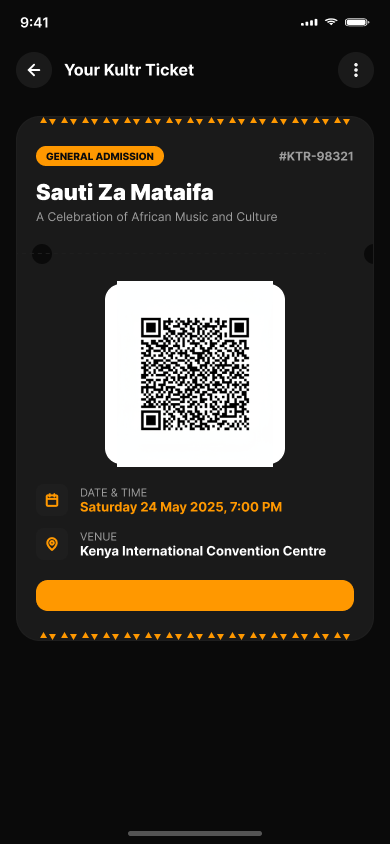 | 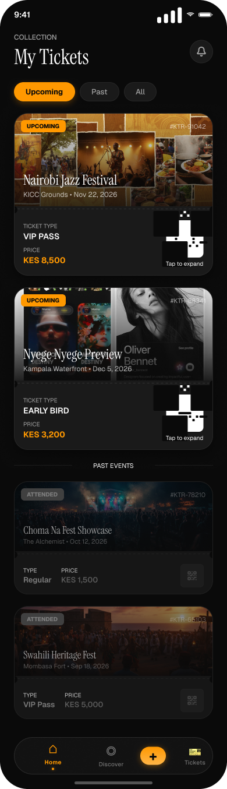 | 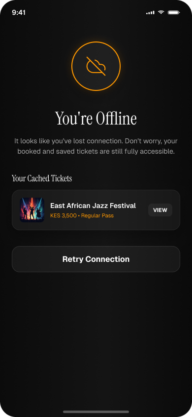 |

---

### Journey 4: Organizer Creating a Multi-Tier Event with Drink Pass Allocation
- **User Role:** Event Organizer (`The Culture Creator`).
- **Trigger:** Taps center FAB button on mobile tab bar (`app/(tabs)/_layout.tsx`).
- **Step-by-Step Flow:**
  1. *Step 1 — Creator Onboarding:* Verification of identity, creator profile name, and bank/mobile money account.
  2. *Step 2 — Event Basics (`app/create-event.tsx`):* Enters title ("Afro Fusion Lagos"), category ("Music"), venue ("Eko Atlantic"), and selects city ("Lagos 🇳🇬").
  3. *Step 3 — Date & Time:* Picks event date and time using native datetime picker.
  4. *Step 4 — Ticket Tiers:* Adds "Early Bird" (₦10,000, qty 100) and "VIP" (₦35,000, qty 50).
  5. *Step 5 — Beverage Allocation:* Toggles "Include Kultr Canned Drinks & Express Bar Pass". Allocates 100 4-packs to enable the festival express bar lane.
  6. *Step 6 — Submission:* Reviews listing and taps "Submit Event". System dispatches `POST /api/events`. Event enters `status: 'review'` with celebratory feedback.
- **Visual References:**
  - Creator Onboarding: `assets/kultr-creator-onboarding-r.png`
  - Create Event Builder: `assets/kultr-create-event.png`
  - Event Management: `assets/kultr-event-management.png`
  - Event Review Status: `assets/kultr-event-status-review-r.png`

| Creator Onboarding | Create Event Form | Event Management | Under Review State |
|:---:|:---:|:---:|:---:|
| 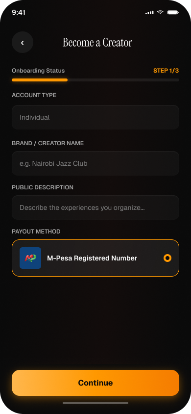 |  | 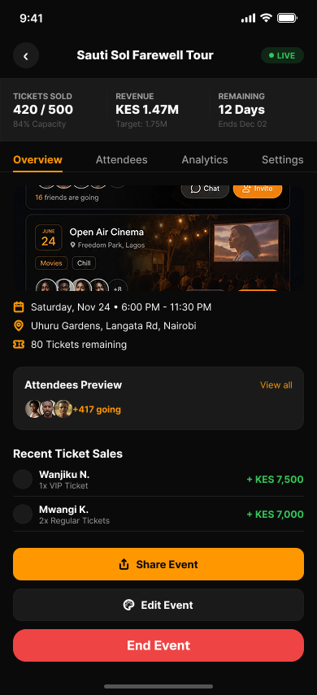 | 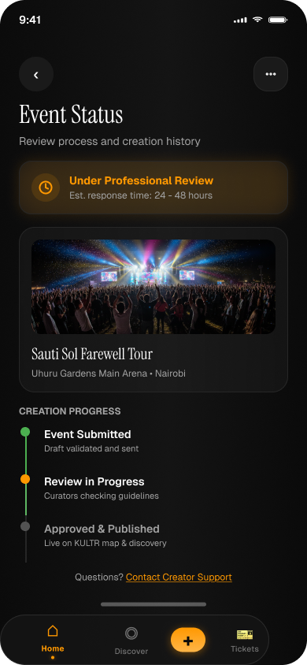 |

---

### Journey 5: Administrator Reviewing & Moderating Submitted Events
- **User Role:** Trust & Safety Administrator.
- **Step-by-Step Flow:**
  1. *Admin Console (`app/admin.tsx`):* Admin navigates to `/admin`.
  2. *Review Queue:* Opens "Pending Review" queue (`GET /api/events?status=review`).
  3. *Inspection:* Reviews organizer history, venue validity, ticket pricing, and promotional artwork.
  4. *Action:* Taps "Approve Event" (`PATCH /api/events/:id/status` with `status: 'live'`).
  5. *System Notification:* Backend automatically triggers `notify(creatorId, 'event_approved')`, and the event appears in the public feed.
  6. *User Reporting:* If reported by users via `Report Event` modal, flagged listings are queued for immediate audit.
- **Visual References:**
  - Admin Review Console: `assets/kultr-admin-review-r.png`
  - Report Event Modal: `assets/kultr-report-event-r.png`

| Admin Moderation Queue | Community Report Modal |
|:---:|:---:|
|  | 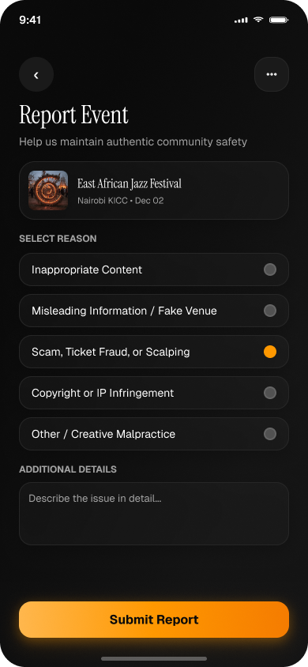 |

---

### Journey 6: Bartender & Door Staff Scanning & Ticket Check-In
- **User Role:** Festival Staff & Bartenders.
- **Trigger:** Launches Staff Scanner via Creator Studio (`app/creator-studio.tsx`).
- **Step-by-Step Flow:**
  1. *Camera Activation:* Scanner opens camera feed in high-framerate barcode detection mode.
  2. *Scan & Decrypt:* Attendee presents digital Bar Pass or Event Ticket. Scanner reads QR data payload:
     `{ ticketId, eventId, attendeeName, signature }`.
  3. *Status Feedback:* Instant visual overlay (green checkmark for valid admission; red alert for duplicate/invalid scan) plus audio and haptic buzz.
  4. *Attendee Roster Override:* Staff can search attendee list manually if camera or screen is damaged.
  5. *Audit Logging:* App logs redemption in database, updates ticket status to `'used'`, and syncs offline buffer once connection resumes.
- **Visual References:**
  - Door QR Scanner: `assets/kultr-qr-scanner-r.png`
  - Check-in Confirmation: `assets/kultr-event-checkin-r.png`
  - Attendee Roster: `assets/kultr-attendee-list-r.png`

| Optical Scanner Feed | Check-in Confirmation | Attendee Guestlist |
|:---:|:---:|:---:|
|  | 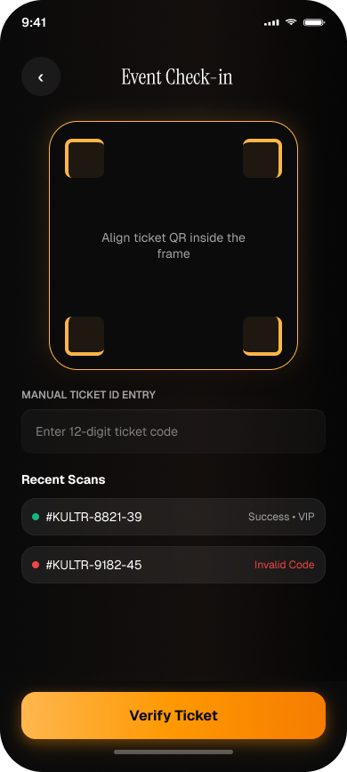 | 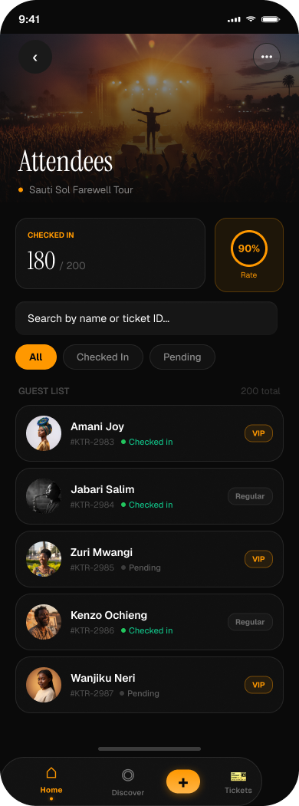 |

---

### Journey 7: Gamification, Quests & Kultroin Perks
- **User Role:** Engaged Community Member.
- **Trigger:** Taps "Quests & Rewards" tab.
- **Step-by-Step Flow:**
  1. *Quests Hub (`app/quests.tsx`):* Displays active challenges ("Check in at 2 Lagos music festivals", "Invite 3 friends").
  2. *Points Accumulation:* Completing tasks credits KULTROINS to user's wallet with ledger audit log.
  3. *Streaks & Badges:* User earns cultural badges (e.g., "Afrobeats Pioneer", "Carnival Veteran") and climbs diaspora leaderboard.
  4. *KULTR PASS Upgrade:* Attendee unlocks priority queue, bar discounts, and exclusive events via monthly KULTR PASS.
  5. *Perks Redemption:* User redeems KULTROINS in Perks Catalog for free beverage vouchers or ticket discounts.
- **Visual References:**
  - Quests Screen: `assets/kultr-quests.png`
  - Kultroin Wallet: `assets/kultr-kultroin-wallet-r.png`
  - Streaks & Badges: `assets/kultr-streaks-badges.png`
  - Perks Catalog: `assets/kultr-perks-catalog-r.png`
  - Perk Unlock Success: `assets/kultr-perk-unlock-success-r.png`

| Quests Hub | Kultroin Wallet | Badges & Streaks | Perk Unlock |
|:---:|:---:|:---:|:---:|
| 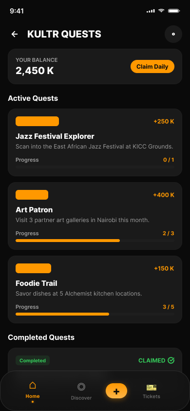 | 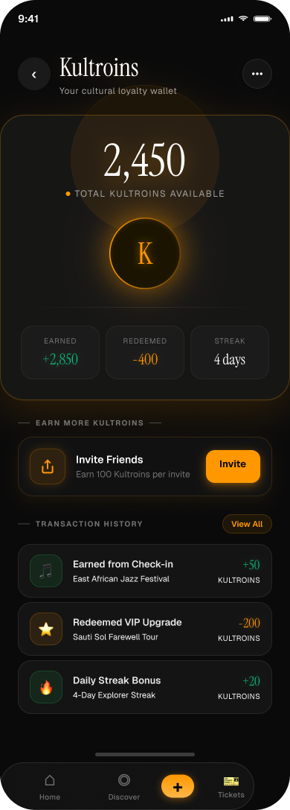 | 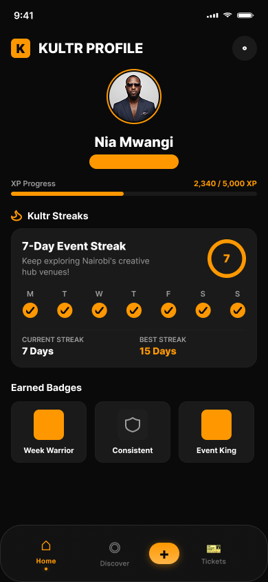 | 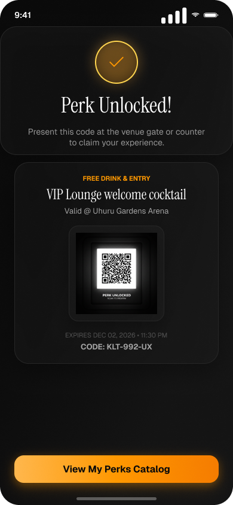 |

---

### Journey 8: Vibe Tribes, Social Hub & Community Engagement
- **User Role:** Social Eventgoer.
- **Trigger:** Taps "Social Hub" on navigation.
- **Step-by-Step Flow:**
  1. *Social Hub Feed:* See what cultural events friends are attending, read comments, and share event cards.
  2. *Vibe Tribes:* Join genre-based micro-communities (e.g., "Amapiano London", "Carnival Masqueraders").
  3. *Tribe Curators:* Follow cultural tastemakers, resident DJs, and trusted event curators.
  4. *Live In-Event Check-in:* Share live presence at a festival to meet up with fellow community members.
- **Visual References:**
  - Social Hub: `assets/kultr-social-hub.png`
  - Vibe Tribes: `assets/kultr-vibe-tribes.png`
  - Tribe Leaders: `assets/kultr-tribe-leaders-r.png`
  - Social Check-in: `assets/kultr-social-checkin.png`

| Social Feed | Vibe Tribes | Tribe Leaders | Social Check-in |
|:---:|:---:|:---:|:---:|
| 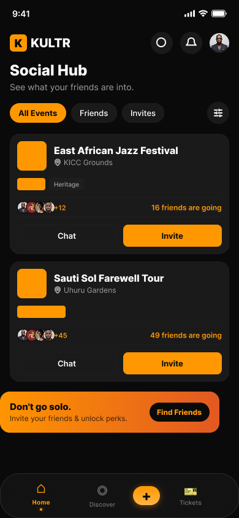 | 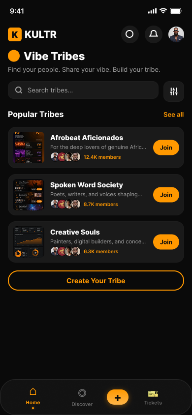 | 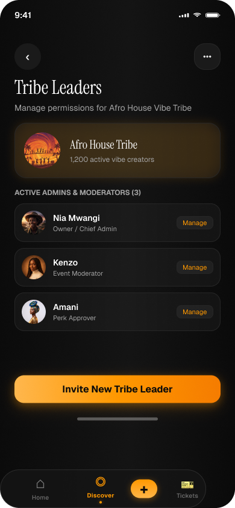 | 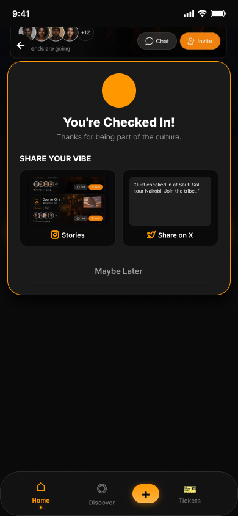 |

---

### Journey 9: Creator Analytics & Multi-Method Payouts
- **User Role:** Event Creator & Finance Lead.
- **Trigger:** Creator Studio → "Analytics & Payouts".
- **Step-by-Step Flow:**
  1. *Dashboard Performance:* View real-time Gross Merchandise Value (GMV), ticket conversion rate, and revenue by tier.
  2. *Sales Velocity:* Inspect hourly ticket velocity curves to optimize marketing campaigns.
  3. *Payout Request:* Tap "Request Payout", choose settlement destination (M-Pesa, Bank Wire, MTN MoMo), and enter amount.
  4. *Settlement Audit:* Review transaction history with fee breakdown, platform commissions, and payout reference codes.
- **Visual References:**
  - Creator Dashboard: `assets/kultr-creator-dashboard.png`
  - Analytics Detail: `assets/kultr-analytics-detail-r.png`
  - Payouts Engine: `assets/kultr-payouts-r.png`
  - Transaction History: `assets/kultr-transaction-history-r.png`

| Creator Dashboard | Analytics Detail | Payouts Engine | Transaction Ledger |
|:---:|:---:|:---:|:---:|
|  |  |  | 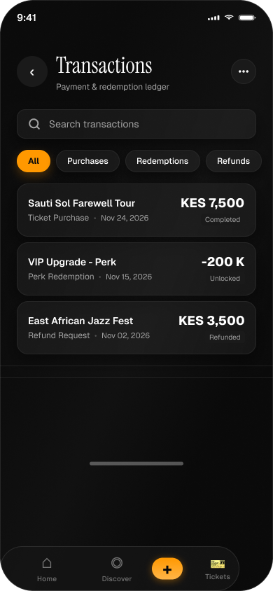 |

---

## 2. Accessibility (a11y) & Ergonomic Standards

Kultr adheres strictly to **WCAG 2.1 AA** accessibility requirements and mobile ergonomic best practices:
- **Minimum Touch Targets:** All interactive buttons, chips, and icons enforce a minimum `48x48dp` tap target.
- **Contrast Ratios:** Text primary (`#FFFFFF`) against dark background (`#0D0D0D`) delivers an 18.2:1 contrast ratio, far exceeding AAA compliance (7:1). Accent color (`#FF6B00`) delivers 5.1:1 against dark backgrounds, exceeding AA guidelines (4.5:1).
- **Screen Reader Support:** Every image and interactive control includes explicit `accessibilityLabel`, `accessibilityRole`, and `accessibilityHint` props.
- **One-Handed Thumb Reach:** Critical primary CTAs ("Get Tickets", "Pay Now", "Scan QR") are anchored to the bottom 30% of the mobile viewport ("Thumb Zone").
- **Dynamic Type Scaling:** Text components support iOS Dynamic Type and Android font scaling without breaking layout boundaries.
- **Offline States & Resilient Fallbacks:** Network disconnects gracefully render offline badges and cached ticket QR codes without application crash or data corruption.
