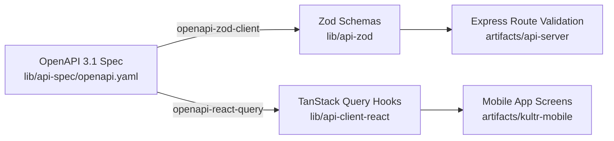
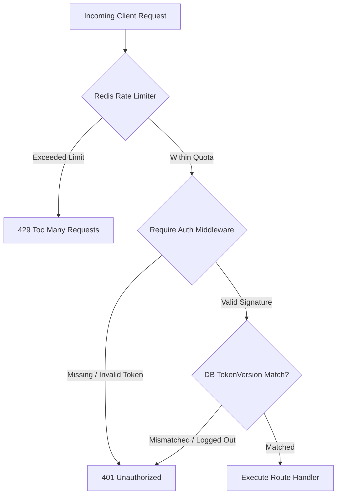

# 07 — Engineering & System Architecture

> **Volume 07 — Deep Technical Due-Diligence, Topologies & Execution Invariants**  
> **Prepared by:** Chief Technology Officer & Principal Infrastructure Engineer  
> **Evidence Status:** `VERIFIED` across monorepo source files, configurations, and build pipelines

---

## 1. Monorepo Structure & Package Dependencies

The Kultr codebase is architected as a clean, highly modular TypeScript monorepo managed via `pnpm` workspaces (`pnpm-workspace.yaml`).

```
kultr-hub/
├── artifacts/
│   ├── api-server/         # Node.js 24 / Express 5 API Server
│   │   ├── src/
│   │   │   ├── app.ts      # Express middleware pipeline, rate limiting, Sentry
│   │   │   ├── index.ts    # HTTP server boot & port binding
│   │   │   ├── lib/        # Core engines: mpesa, momo, paystack, issue, jwt
│   │   │   ├── middleware/ # auth, validateUuidParam, rate limiting
│   │   │   └── routes/     # 14 route controllers (/auth, /events, /payments, etc.)
│   │   └── package.json
│   │
│   ├── kultr-mobile/       # React Native / Expo Router v54 Client Application
│   │   ├── app/            # File-based routing (tabs, event, checkout, bar-pass)
│   │   ├── components/     # EventCard, QRDisplay, CategoryPill, CountryPicker
│   │   ├── context/        # AppContext (Auth, Country, Currency, RTL state)
│   │   ├── hooks/          # useEventCatalog, useQuests, useColors
│   │   └── constants/      # currencies (10 diaspora currencies), data
│   │
│   └── mockup-sandbox/     # Isolated component styling and design sandbox
│
├── lib/
│   ├── api-spec/           # Canonical OpenAPI 3.1 contract (openapi.yaml)
│   ├── api-zod/            # Auto-generated Zod request/response validation schemas
│   ├── api-client-react/   # Auto-generated TanStack React Query v5 client hooks
│   └── db/                 # PostgreSQL schema, Drizzle ORM, versioned migrations
│       ├── migrations/     # Versioned SQL migrations (0000 - 0009)
│       └── src/
│           ├── schema/     # 24 relational table schemas
│           ├── index.ts    # Database client connection pool (pg / Drizzle)
│           └── seed.ts     # Global diaspora seed events & catalogs
│
├── docs/                   # Authoritative intelligence knowledge base
└── package.json            # Root configuration and workspace typecheck scripts
```

---

## 2. API Contract Pipeline & Code Generation

A cornerstone of Kultr's engineering rigor is its **Contract-First API Architecture**. Code is never hand-duplicated across the mobile app and backend.



1. **Canonical Contract (`lib/api-spec/openapi.yaml`):** Defines 44 REST endpoints with full JSON schema request bodies, parameter validation, and HTTP status codes.
2. **Runtime Validation (`lib/api-zod`):** Compiles the OpenAPI schema into TypeScript Zod validators (e.g. `CreateEventBody`). The Express API validates incoming payloads using these schemas before executing business logic.
3. **Type-Safe React Query Hooks (`lib/api-client-react`):** Compiles the OpenAPI schema into strongly-typed TanStack React Query v5 hooks (e.g. `useListEvents`, `useGetEvent`, `useCreateEvent`). Mobile screens consume these hooks directly, guaranteeing end-to-end type safety.

---

## 3. Transaction Safety & Concurrency Control

In high-demand event ticketing, thousands of concurrent buyers may attempt to purchase the last 10 remaining VIP tickets within a single second. Naive read-then-write updates inevitably cause catastrophic overselling.

Kultr resolves this through **Database-Level Pessimistic Locking**:

```typescript
// Verified from artifacts/api-server/src/lib/issue.ts:25-50
export async function issueTicket(
  tx: DatabaseTransaction,
  params: IssueTicketParams
): Promise<Ticket> {
  const { eventId, ticketTypeId, userId, quantity } = params;

  // 1. Pessimistic Row Lock: Blocks concurrent transactions targeting this ticket tier
  const [ticketType] = await tx
    .select()
    .from(ticketTypesTable)
    .where(eq(ticketTypesTable.id, ticketTypeId))
    .for("update"); // <-- PostgreSQL SELECT ... FOR UPDATE

  // 2. Strict Capacity Check
  const available = ticketType.totalQuantity - ticketType.soldQuantity;
  if (available < quantity) {
    throw new TicketIssueError("sold_out", `Only ${available} ticket(s) remaining`);
  }

  // 3. Atomic Inventory Decrement
  await tx
    .update(ticketTypesTable)
    .set({
      soldQuantity: sql`${ticketTypesTable.soldQuantity} + ${quantity}`,
    })
    .where(eq(ticketTypesTable.id, ticketTypeId));

  // 4. Cryptographic Ticket Insertion
  const qrHash = generateSecureQrHash(userId, eventId, ticketTypeId);
  const [ticket] = await tx
    .insert(ticketsTable)
    .values({ userId, eventId, ticketTypeId, quantity, qrCodeHash: qrHash, status: "confirmed" })
    .returning();

  return ticket;
}
```

- **Guaranteed Invariant:** The database engine serializes all purchases targeting the same `ticket_types` row. If 1,000 requests hit the endpoint simultaneously, exactly the available quantity will succeed; subsequent transactions receive a handled `409 Conflict ("sold_out")`.
- **Beverage Vouchers:** An identical pessimistic lock governs `event_beverage_bundles.sold_quantity` in `artifacts/api-server/src/lib/issue-voucher.ts`.

---

## 4. Mobile Client Architecture

- **Runtime:** React Native 0.79 with Expo SDK 54, running Expo Router v54 for file-based route navigation.
- **Rendering Performance:** 60fps scrolling backed by React Native `FlatList` and `ScrollView` components with item height caching.
- **State Management:**
  - *Server State:* TanStack React Query v5 (`@tanstack/react-query`) with automatic cache deduplication, background revalidation, and optimistic updates.
  - *Client State:* Lightweight React Context (`AppContext.tsx`) managing authentication tokens, active country/currency profile, and RTL layout mode.
- **Storage Tier:** `@react-native-async-storage/async-storage` for offline persistence of auth tokens, search history, and ticket cache.

---

## 5. Security & Rate Limiting Subsystem



- **Rate Limiting (`artifacts/api-server/src/app.ts`):** Redis-backed sliding-window rate limiter using `express-rate-limit` and `rate-limit-redis`.
  - Global API: 120 requests per minute per IP.
  - Auth Endpoints: 10 requests per minute to prevent brute-force attacks.
  - OTP Requests: 3 requests per minute per phone number.
  - Fallback: Gracefully degrades to in-process memory rate limiting if Redis is unconfigured or unreachable.
- **Revocable JWTs (`artifacts/api-server/src/lib/jwt.ts`):** JWTs are signed with HS256 and a required 32-character secret in production. Every token embeds `tokenVersion`. Calling `POST /api/auth/logout` increments `users.token_version`, instantly invalidating all outstanding tokens across all devices.

---

## 6. Architectural Trade-Off Analysis: Modular Monolith vs Microservices

The original architecture brief (`attached_assets/...Architecture...md`) proposed a distributed microservices setup (User Service, Event Service, Payment Service, AI Service, Notification Service, Data Warehouse).

**The Engineering Assessment:**
- **Why a Modular Monolith Was Chosen (`VERIFIED`):** At Kultr's current scale (pre-launch to 500,000 monthly active users), microservices introduce severe anti-patterns: distributed transaction failures, network latency, multi-repository coordination overhead, and complex service mesh maintenance.
- **The Current Architecture:** A well-structured **Modular Monolith** running within a single Express application, cleanly separated into domain boundaries (`routes/`, `lib/`, `schema/`).
- **Scalability Path:** The modular monolith can effortlessly scale vertically and horizontally (stateless Node.js processes behind a load balancer with Redis sessions and a managed PostgreSQL read-replica cluster) to handle 10,000+ requests per second before service decomposition is ever required.
