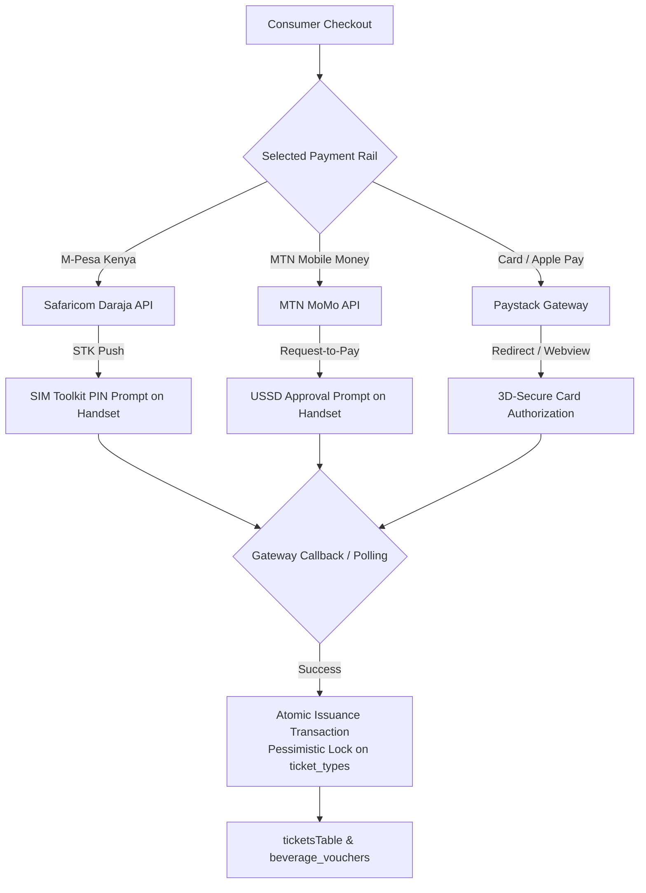

# 11 — Payments, Ticketing & Payout Engine

> **Volume 11 — Payment Gateway Integrations, Ticket Issuance & Financial Settlement**  
> **Prepared by:** Chief Financial Officer & Senior Fintech Integration Engineer  
> **Evidence Status:** `VERIFIED` across `lib/mpesa.ts`, `lib/mtn-momo.ts`, `lib/paystack.ts`, `lib/issue.ts`, and `routes/payouts.ts`

---

## 1. Omnichannel Payment Architecture

Kultr bridges Western card processing with native Sub-Saharan mobile money rails, ensuring zero payment friction across all customer demographics.



---

## 2. Gateway Implementation Details

### 2.1 Safaricom M-Pesa Daraja Integration (`artifacts/api-server/src/lib/mpesa.ts`)
- **API Spec:** M-Pesa Daraja 2.0 REST API (Lipa Na M-Pesa Online / STK Push).
- **Authentication:** OAuth 2.0 client credentials (`DARAJA_CONSUMER_KEY` + `DARAJA_CONSUMER_SECRET`) generating a bearer token cached with 50-minute TTL.
- **Request Generation:**
  $$\text{Password} = \text{Base64}(\text{ShortCode} \parallel \text{Passkey} \parallel \text{Timestamp YYYYMMDDHHmmss})$$
- **Payload:** Dispatches to `https://api.safaricom.co.ke/mpesa/stkpush/v1/processrequest`.
- **Handset Behavior:** The buyer's handset immediately rings with a native SIM Toolkit prompt requesting their M-Pesa PIN.
- **Verification:** The backend queries transaction status via `/mpesa/stkpushquery/v1/query` using `CheckoutRequestID`.

### 2.2 MTN Mobile Money Integration (`artifacts/api-server/src/lib/mtn-momo.ts`)
- **API Spec:** MTN MoMo Open API (Collection Service).
- **Markets Supported:** Uganda (`UGX`), Ghana (`GHS`), Rwanda (`RWF`), Côte d'Ivoire (`XOF`), Cameroon (`XAF`).
- **Flow:** Dispatches a `POST /collection/v1_0/requesttopay` referencing a unique `X-Reference-Id` (UUIDv4) and subscriber MSISDN.
- **Handset Behavior:** The user receives a USSD debit push to authorize the mobile money transfer.
- **Status Polling:** Evaluates payment state via `GET /collection/v1_0/requesttopay/{referenceId}` (`SUCCESSFUL`, `FAILED`, `PENDING`).

### 2.3 Paystack Card Processing (`artifacts/api-server/src/lib/paystack.ts`)
- **API Spec:** Paystack Standard API.
- **Currencies Supported:** USD, GBP, EUR, KES, NGN, GHS, ZAR.
- **Flow:** Dispatches `POST https://api.paystack.co/transaction/initialize` with amount in lowest currency subunits (kobo/cents). Returns an `authorization_url` rendered within an in-app browser or native webview.
- **Verification:** Queries `GET https://api.paystack.co/transaction/verify/{reference}` to confirm authorization before issuance.

---

## 3. Strict Simulation Gating (`artifacts/api-server/src/lib/simulation.ts`)

A catastrophic vulnerability in many developer MVPs is relying on client-supplied flags (e.g. `isSimulated=true` or `testMode=true`) to bypass payment gateways during local development. If pushed to production, any malicious caller can mint millions of dollars in free tickets.

Kultr completely eliminates this risk via a **hardcoded server-side barrier**:

```typescript
// Verified from artifacts/api-server/src/lib/simulation.ts:12-15
export function simulationAllowed(providerConfigured: boolean): boolean {
  const isProduction = process.env.NODE_ENV === "production";
  return !isProduction && !providerConfigured;
}
```

- In production (`NODE_ENV === "production"`), `simulationAllowed()` unconditionally returns `false`.
- If an unconfigured provider is called in production, the transaction fails fast with a configuration error; under no circumstances will a simulated ticket or voucher be minted.

---

## 4. Ticket & Drink Pass Issuance Engine (`lib/issue.ts` & `lib/issue-voucher.ts`)

Issuance is atomic and wrapped in a PostgreSQL transaction:
1. **Quantity Assertion:** `validateQuantity(quantity)` enforces $1 \le \text{quantity} \le 10$ tickets per transaction.
2. **Pessimistic Lock:** `SELECT ... FROM ticket_types WHERE id = ... FOR UPDATE` acquires an exclusive lock.
3. **Capacity Check:** If `soldQuantity + quantity > totalQuantity`, rollback transaction and return `409 Conflict`.
4. **Inventory Update:** `sold_quantity = sold_quantity + quantity`.
5. **Ticket Record Creation:** Inserts row into `ticketsTable` with cryptographic QR hash.
6. **Drink Bundle Add-on:** If `beverageBundleId` was present in checkout, locks `event_beverage_bundles`, increments its `sold_quantity`, and inserts a `beverage_vouchers` record with HMAC signature.

---

## 5. Creator Payout Balance Engine (`routes/payouts.ts`)

```typescript
// Verified from artifacts/api-server/src/routes/payouts.ts:28-57
async function computeBalances(creatorId: string, dbOrTx: DbOrTx = db) {
  // 1. Sum of all confirmed ticket sales for creator's events
  const revenueByCurrency = await dbOrTx
    .select({
      currency: ticketsTable.currency,
      revenue: sql<number>`coalesce(sum(${ticketsTable.totalAmount}), 0)`,
    })
    .from(ticketsTable)
    .innerJoin(eventsTable, eq(ticketsTable.eventId, eventsTable.id))
    .where(and(eq(eventsTable.creatorId, creatorId), eq(ticketsTable.status, "confirmed")))
    .groupBy(ticketsTable.currency);

  // 2. Sum of all pending and paid payout requests
  const requestedByCurrency = await dbOrTx
    .select({
      currency: payoutsTable.currency,
      requested: sql<number>`coalesce(sum(${payoutsTable.amount}), 0)`,
    })
    .from(payoutsTable)
    .where(and(eq(payoutsTable.creatorId, creatorId), inArray(payoutsTable.status, ["pending", "paid"])))
    .groupBy(payoutsTable.currency);

  // 3. Exact Available Balance = Revenue - (Pending + Paid)
  return revenueByCurrency.map((r) => {
    const revenue = Number(r.revenue);
    const requested = requestedMap.get(r.currency) ?? 0;
    return { currency: r.currency, revenue, requested, available: revenue - requested };
  });
}
```

### Critical Operational Analysis: The Payout Gap
- **What is Verified (`VERIFIED`):** The balance calculation is mathematically exact, grouped by currency, locked against race conditions, and prevents organizers from requesting more than their earned net revenue.
- **What is Unimplemented (`VERIFIED GAP`):** The final stage of payout resolution (`PATCH /api/payouts/:id -> status: 'paid'`) is an administrative manual marker. There is currently **no automated money-movement rail** (e.g. M-Pesa B2C API or Paystack Transfer API) hooked up to automatically disburse funds to the creator's bank account or mobile wallet. This must be prioritized for Stage 2 operations.
