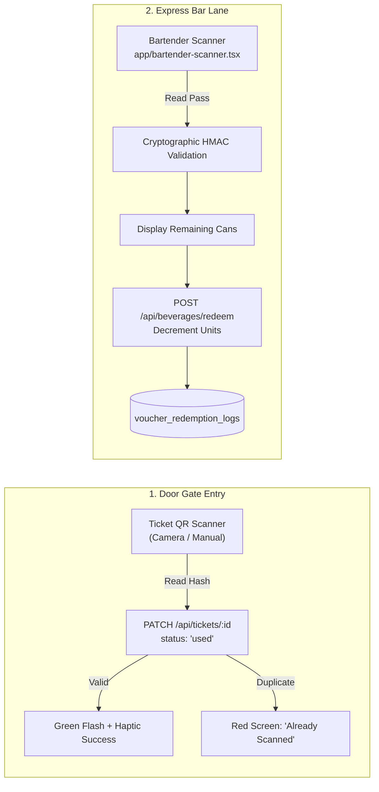
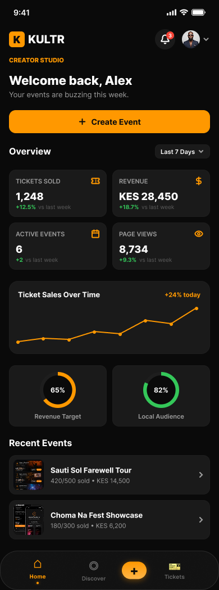
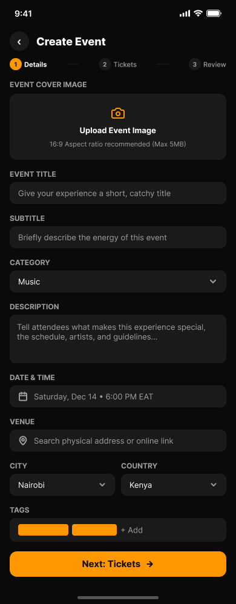
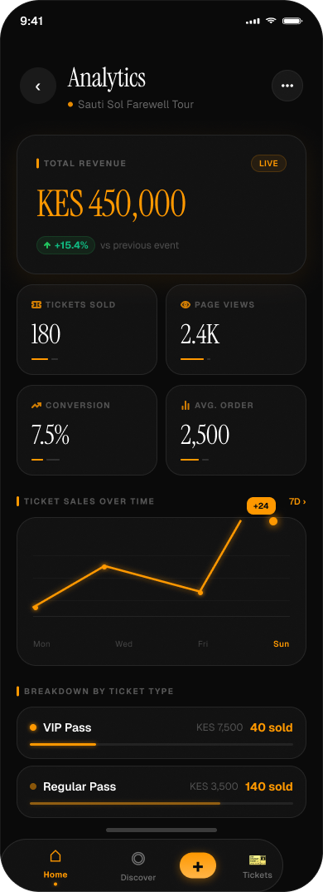
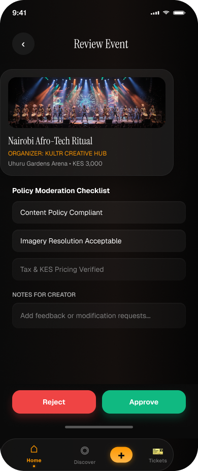
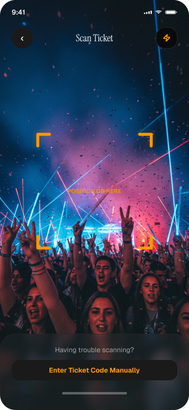
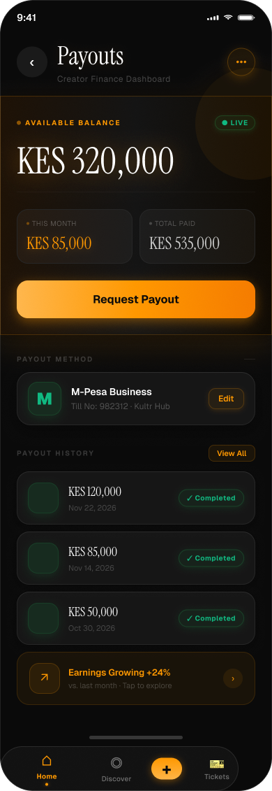

# 12 — Creator Studio & Admin Moderation Operations

> **Volume 12 — Creator Lifecycle, Operational Workflows, Administrative Controls & UI Suite**  
> **Prepared by:** Head of Operations & Lead Product Designer  
> **Evidence Status:** `VERIFIED` across `app/creator-studio.tsx`, `app/admin.tsx`, `app/bartender-scanner.tsx`, and Figma UI screens

---

## 1. Creator Studio Architecture (`app/creator-studio.tsx`)

The **Kultr Creator Studio** is a self-contained operational command center engineered specifically for mobile organizers, promoters, and venue managers.

```
┌────────────────────────────────────────────────────────────────────────┐
│                        CREATOR STUDIO OVERVIEW                         │
├─────────────────────┬─────────────────────┬────────────────────────────┤
│ 1. SALES ANALYTICS  │ 2. EVENT CONTROLS   │ 3. OPERATIONAL TOOLS       │
├─────────────────────┼─────────────────────┼────────────────────────────┤
│ • Gross Ticket GMV  │ • Multi-Tier Setup  │ • Door Gate Scanner        │
│ • Total Tickets Sold│ • Drink Allocation  │ • Bartender Pass Scanner   │
│ • Remaining Capacity│ • Status Tracking   │ • Payout Balance & Request │
└─────────────────────┴─────────────────────┴────────────────────────────┘
```

### 1.1 Real-Time Analytics Dashboard
Organizers access live sales intelligence via `GET /api/events/creator/analytics`:
- **Total Revenue (GMV):** Aggregated gross revenue across all confirmed ticket sales, formatted in local currency (e.g. `KSh 1,450,000` or `₦8,500,000`).
- **Total Tickets Sold:** Real-time count of tickets issued across all active and past listings.
- **Active Events Count:** High-level status of events currently live on the platform.
- **Sales Velocity:** Real-time inventory status displaying exact remaining tickets per tier to inform marketing campaigns.

### 1.2 Event Lifecycle & Submission Engine (`app/create-event.tsx`)
1. **Creation Form:** Intuitive multi-step form capturing event metadata (Title, Subtitle, Category, City, Venue, Date/Time, Artwork).
2. **Dynamic Ticket Tiers:** Creators configure custom ticket categories (Early Bird, Regular, VIP, Table) with individual quotas and prices.
3. **Beverage Bundle Allocation:** Creators can optionally toggle "Kultr Canned Drinks & Express Bar Pass" allocations (100, 250, 500, or 1000 4-packs), generating pre-sale inventory directly on the event.
4. **The Review Gate Invariant:** Submitted events are assigned `status: 'review'` in `eventsTable`. They are completely hidden from public discovery feeds and search queries until approved by an administrator, preventing scam or duplicate listings.

---

## 2. Administrator Moderation Console (`app/admin.tsx`)

The Admin Suite provides platform operators with complete governance over listings, user trust, disputes, and financial settlements.

### 2.1 Event Review Queue (`GET /api/events?status=review`)
- **Review Workflow:** Displays pending event submissions with organizer account age, venue details, pricing tiers, and uploaded promotional graphics.
- **Moderation Actions (`PATCH /api/events/:id/status`):**
  - **Approve (`'live'`):** Instantly publishes the event to the global discovery feed and sends an automated notification to the creator.
  - **Reject (`'rejected'`):** Rejects the listing with feedback provided to the creator.
  - **Terminate (`'ended'`):** Terminates an event early in cases of emergency, cancellation, or venue dispute.

### 2.2 Fraud & Abuse Report Triage (`GET /api/events/admin/reports`)
- Attendees can file dispute reports on any event (`POST /api/events/:id/report`) specifying reasons: `misleading_listing`, `suspected_scam`, `inappropriate_content`, or `duplicate_event`.
- The Admin Console displays the dispute queue sorted by urgency. Admins can inspect reporter details and mark reports as `reviewed` or `dismissed` (`PATCH /api/events/admin/reports/:id`). If fraud is confirmed, the admin transitions the event status to `'rejected'`.

### 2.3 Organizer Trust Badging (`PATCH /api/users/:id/verify`)
- Administrators can grant or revoke the **"Verified Organizer"** status (`users.is_verified_organizer`).
- When granted, a verified shield badge appears on all of that organizer's event detail pages (`components/VerifiedBadge.tsx`), dramatically improving buyer confidence and conversion rates.

### 2.4 Payout Resolution Queue (`GET /api/payouts/admin/pending`)
- Displays all pending payout withdrawal requests submitted by organizers.
- Shows requested amount, currency, recipient bank/M-Pesa details, and the system-verified available balance.
- Once the physical transfer is executed via banking rails, the admin updates status to `'paid'` (`PATCH /api/payouts/:id`), logging the resolution timestamp and notifying the organizer.

---

## 3. On-Site Operational Scanning Tools

Kultr includes two specialized operational scanning interfaces accessible directly from the mobile app.



### 3.1 Door Gate Ticket Scanner
- **Hardware Support:** Utilizes the mobile device's native camera via `expo-camera` or `react-native-camera`.
- **Validation Speed:** Processes and validates ticket QR hashes in under 600ms.
- **Anti-Passback Invariant:** Once scanned, the database marks the ticket `status = 'used'` with timestamp `used_at = now()`. A second scan immediately flashes red with the exact time the ticket was previously admitted.

### 3.2 Festival Bartender Scanner (`app/bartender-scanner.tsx`)
- **Purpose:** Fast-track redemption of pre-purchased Kultr Canned Drink 4-packs at festival express bars.
- **Cryptographic Validation:** Checks the HMAC-SHA256 signature encoded inside the QR payload against tampering.
- **Multi-Can Decrement Counter:** Allows dispensing partial units (e.g., attendee redeems 2 cans now and saves 2 cans for later).
- **Offline Sync Queue:** If festival cellular networks fail, the scanner logs redemptions locally with timestamps and device IDs, syncing to `POST /api/beverages/redeem` as soon as connectivity resumes.

---

## 4. Operational Screen Interface Gallery

The Creator Studio and Administrative consoles are realized across modern mobile interfaces:

| Creator Studio Dashboard | Multi-Step Event Builder | Advanced Sales Analytics |
|:---:|:---:|:---:|
|  |  |  |

| Admin Moderation Console | Door & Bar Camera Scanner | Payouts Engine |
|:---:|:---:|:---:|
|  |  |  |
