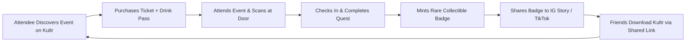

# 17 — Go-To-Market & Growth Playbook

> **Volume 17 — Launch Sequencing, Supply Acquisition & Viral Distribution**  
> **Prepared by:** Chief Marketing Officer & Head of Operations  
> **Evidence Status:** `PROPOSED` (Go-To-Market Execution Plan) & `DOCUMENTED` (Launch Materials in `attached_assets/`)

---

## 1. Dual-Beachhead Geographic Strategy

Marketplaces succeed by achieving dense geographic liquidity rather than thin, diffuse presence. Kultr will execute a **Dual-Beachhead Strategy** anchoring two complementary poles:

```
┌────────────────────────────────────────────────────────────────────────┐
│                        DUAL-BEACHHEAD LAUNCH                           │
├───────────────────────────────────┬────────────────────────────────────┤
│ POLE 1: NAIROBI (Domestic Hub)    │ POLE 2: LONDON (Diaspora Hub)      │
├───────────────────────────────────┼────────────────────────────────────┤
│ • Focus: Music festivals, day     │ • Focus: Black British, Afrobeats, │
│   parties, cultural food popups   │   Amapiano & Caribbean day parties │
│ • Payment: 85% M-Pesa STK Push    │ • Payment: 90% Apple Pay & Cards   │
│ • Key Venues: Alchemist, Muze,    │ • Key Venues: Fabric, Ministry of  │
│   Carnivore, KICC                 │   Sound, Broadwick Live, Shoreditch│
│ • Ticket AOV: $12 – $30           │ • Ticket AOV: £25 – £75 ($32 – $95)│
└───────────────────────────────────┴────────────────────────────────────┘
```

The synergy is immediate: diaspora travelers in London frequently plan trips to Nairobi, Lagos, and Accra, using Kultr as their universal cultural passport.

---

## 2. Supply Acquisition: Winning the Top 20 Promoters

Marketplaces are supply-constrained; event-goers follow the artists and promoters they love. Our supply acquisition playbook focuses on securing **20 marquee event organizers** in each beachhead city:

1. **The "Zero-Fee Trial" Anchor:** Offer the first 3 events with 0% platform fee, saving promoters $1,500–$5,000 compared to legacy ticketing platforms.
2. **The Express Bar Sponsorship:** Provide physical "Kultr Express Bar" signage, branded wristbands, and the pre-sold canned drinks loop for free, driving an immediate 20%+ increase in organizer beverage revenue.
3. **Dedicated Gate Support:** Deploy Kultr field operations staff equipped with pre-configured mobile scanning devices to manage door entry for their first 2 major events.

---

## 3. Demand Generation & Viral Distribution Loops



### 3.1 Organic Viral Loops
- **Social Ticket Reveal:** Dynamic Instagram Story sharing cards generated upon ticket purchase ("I'm going to Afro Fusion Lagos with @Kultr").
- **Tribe Leader Ambassador Network:** Partner with campus ambassadors and creative collective leaders who receive bespoke referral links earning 1% commission on ticket volume or free KULTR PASS subscriptions.
- **Quest Streaks & Status Symbols:** Attendees showcase their "Afrobeats Pilgrim" or "Carnival Connoisseur" collectible badges on social profiles, transforming event attendance into social currency.

---

## 4. Phase-by-Phase Launch Milestones

```
┌────────────────────────────────────────────────────────────────────────┐
│                        LAUNCH ROADMAP & GATES                          │
├──────────────┬──────────────────┬──────────────────────────────────────┤
│ PHASE        │ TIMELINE         │ KEY OBJECTIVES & METRICS             │
├──────────────┼──────────────────┼──────────────────────────────────────┤
│ Phase 1:     │ Months 1–2       │ • 10 closed-pilot events in Nairobi  │
│ Closed Pilot │                  │ • 5,000 tickets processed            │
│              │                  │ • 0% oversell rate; <800ms scan time │
├──────────────┼──────────────────┼──────────────────────────────────────┤
│ Phase 2:     │ Months 3–4       │ • Public rollout in Nairobi & London │
│ Commercial   │                  │ • 50 active promoters; 35,000 tickets│
│ Launch       │                  │ • $850k GMV processed                │
├──────────────┼──────────────────┼──────────────────────────────────────┤
│ Phase 3:     │ Months 5–8       │ • Expansion to Lagos & Accra         │
│ Regional     │                  │ • "Detty December" diaspora campaign │
│ Expansion    │                  │ • 150,000 tickets; $3.5M GMV         │
└──────────────┴──────────────────┴──────────────────────────────────────┘
```
