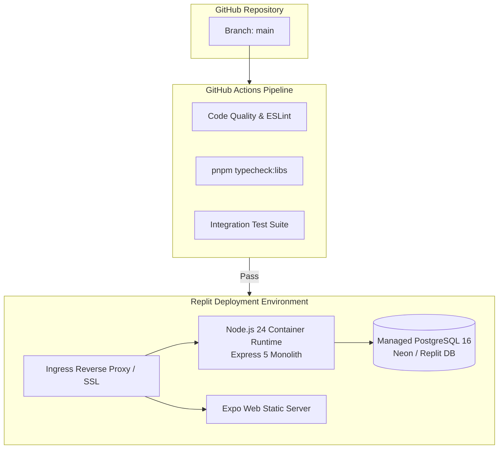

# 19 — Infrastructure, DevOps & Deployment Topology

> **Volume 19 — Hosting Infrastructure, Cloud Architecture & CI/CD Pipelines**  
> **Prepared by:** Principal DevOps Engineer & Site Reliability Lead  
> **Evidence Status:** `VERIFIED` in repository configuration and `.github/workflows/ci.yml`

---

## 1. Current Deployment Topology (Replit Sync)

Kultr's development and staging environments are currently hosted via **Replit**, synchronized continuously from GitHub `main`.



- **Environment Separation:** The runtime distinguishes staging from production strictly via `NODE_ENV`. Simulated payment gateways are completely disabled if `NODE_ENV === "production"`.
- **Database Connection Pool:** Connects to PostgreSQL over TLS via `pg.Pool` (`lib/db/src/index.ts`) with configurable pool limits (`max: 20`, idle timeout: 30s).

---

## 2. Production Scaled Target Topology (AWS / GCP)

For commercial production launch, Kultr should migrate to a cloud-native containerized architecture:

```
┌────────────────────────────────────────────────────────────────────────┐
│                        PRODUCTION TARGET TOPOLOGY                      │
├─────────────────────┬─────────────────────┬────────────────────────────┤
│ EDGE & CDN          │ COMPUTE TIER        │ DATA TIER                  │
├─────────────────────┼─────────────────────┼────────────────────────────┤
│ • Cloudflare Pro    │ • AWS ECS Fargate / │ • AWS RDS PostgreSQL 16    │
│ • DDoS Protection   │   GCP Cloud Run     │   Multi-AZ with Read Rep   │
│ • Static Assets CDN │ • Autoscaling:      │ • AWS ElastiCache Redis    │
│ • SSL Termination   │   2 – 10 instances  │ • AWS S3 Media Bucket      │
└─────────────────────┴─────────────────────┴────────────────────────────┘
```

- **Estimated Monthly Infrastructure Cost (Year 1):** ~$280 – $450/month (Managed PostgreSQL db.t4g.medium, 2x Fargate containers, ElastiCache Redis, S3 bucket).
- **Stateless Web Tier:** Express 5 instances share zero in-memory state; all sessions rely on stateless JWTs and Redis-backed rate limiting, allowing seamless horizontal autoscaling.

---

## 3. Continuous Integration & Delivery Pipeline (`.github/workflows/ci.yml`)

The repository enforces a strict pre-merge CI validation workflow:
1. **Dependency Installation:** `pnpm install --frozen-lockfile` enforcing supply-chain package release age safeguards (`minimumReleaseAge: 1440`).
2. **Type Checking:** `pnpm run typecheck` compiling both root libraries and artifact packages without type errors.
3. **Automated Integration Tests:** Executes Jest/Vitest suites validating authentication token revocation, payment simulation security, and ticket quantity concurrency.

---

## 4. Observability, Logging & Error Telemetry

- **Structured Logging (`lib/logger.ts`):** Implemented using **Pino** producing structured JSON logs with correlation IDs, request method, status codes, and latency in milliseconds.
- **Error Tracking & APM (`instrument.ts`):** **Sentry** SDK initialized across both the API server and the mobile application, capturing uncaught exceptions, unhandled Promise rejections, and slow database queries.
